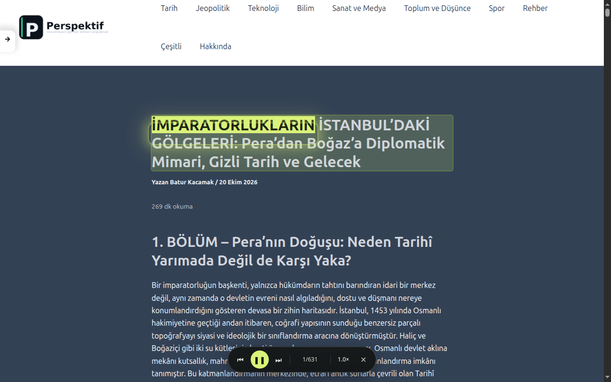
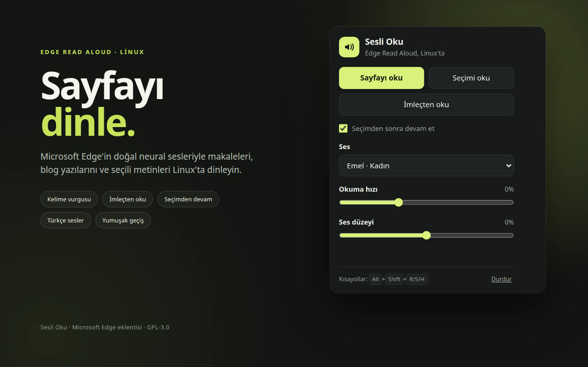
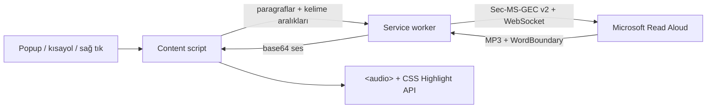
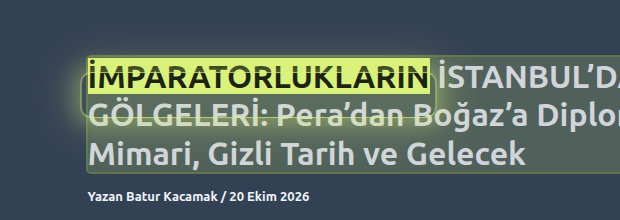

<div align="center">


# Sesli Oku

**Microsoft Edge için Linux'ta Read Aloud.**

Edge'in doğal neural sesleriyle sayfaları, seçimleri ve imlecin olduğu yeri okuyan
Manifest V3 eklentisi. API anahtarı yok, hesap yok, kurulum derdi yok.

[](manifest.json)
[](LICENSE)
[](manifest.json)
[](https://www.microsoft.com/edge)
[](#)
[](#)

[Kurulum](#kurulum) · [Kullanım](#kullanım) · [Nasıl çalışır?](#nasıl-çalışır) · [Kelime vurgusu](#kelime-vurgusu) · [Gizlilik](#gizlilik) · [Sorun giderme](#sorun-giderme)

</div>

---

<p align="center">
  
</p>

## Neden Sesli Oku?

Microsoft Edge'in **Read Aloud** özelliği Windows ve macOS'ta var; **Linux'ta yok.**
Edge Linux'ta ne menüde ne de sağ tık menüsünde bu özellik bulunuyor. Sesli Oku,
Edge'in kendi Read Aloud servisini doğrudan kullanarak bu boşluğu dolduruyor:

- Aynı Microsoft neural sesleri (Türkçe **Emel** ve **Ahmet** dahil)
- Sayfa metnini **paragraf paragraf** okuma
- Okunan **kelimeyi makalenin kendi metninde** vurgulama
- İmleçten, seçimden veya sayfanın tamamından başlatma
- Oynatıcıda canlı hız, duraklatma, önceki/sonraki paragraf

> [!NOTE]
> Bu eklenti Microsoft'un resmî olmayan Read Aloud uç noktasını kullanır.
> Microsoft ile bağlantılı değildir. Uç nokta veya token algoritması
> değişebilir; böyle durumlarda güncelleme gerekir.

## Öne çıkanlar

| Alan | Ne yapar |
| --- | --- |
| **Sesler** | 300'den fazla Microsoft neural sesi; Türkçe Emel ve Ahmet hazır |
| **Okuma** | Sayfanın tamamı, seçili metin veya imlecin bulunduğu cümle |
| **Vurgu** | Paragraf + kelime vurgusu; yumuşak geçişli, tema duyarlı ışık halkası |
| **Takip** | Metin görünümden çıkınca otomatik kaydırma; elle kaydırınca duraklar, **Okumaya dön** ile devam eder |
| **Akış** | Paragraf buffer'ı + bir sonraki paragrafı önceden hazırlama; dev MP3 yok |
| **Oynatıcı** | Canlı hız (0.75×–2×), duraklat, önceki/sonraki paragraf, durdur |
| **Erişim** | Klavye kısayolları, sağ tık menüsü ve popup |
| **Gizlilik** | Geliştiriciye veri gitmez; ayarlar yalnızca `chrome.storage.local` içinde |
| **Kurulum** | Derleme yok, bağımlılık yok; klasörü Edge'e yükle veya ZIP kullan |

## Ekran görüntüleri

<table>
  <tr>
    <td width="62%" valign="top">
      
      <br />
      <sub>Gerçek bir blog yazısında paragraf ve kelime vurgusu, alt oynatıcı.</sub>
    </td>
    <td width="38%" valign="top">
      
      <br />
      <sub>Popuptan ses, hız ve seçimden devam ayarları.</sub>
    </td>
  </tr>
</table>

## Kurulum

### Gereksinimler

- **Microsoft Edge 116+** (Linux)
- İnternet bağlantısı (ses sentezi Microsoft servisinde yapılır)
- Edge'de **Geliştirici modu** (paketlenmemiş yükleme için)

### Yöntem 1 — Kaynak klasörden (önerilen)

```bash
git clone https://github.com/baturkacamak/edge-read-aloud.git
cd edge-read-aloud
```

1. `edge://extensions` adresini açın.
2. Sağ alttan **Geliştirici modu**nu açın.
3. **Paketlenmemiş öğe yükle** ile bu klasörü seçin.
4. Araç çubuğundaki **Sesli Oku** simgesini sabitleyin.

### Yöntem 2 — Hazır ZIP

[Son sürümü indirin](https://github.com/baturkacamak/edge-read-aloud/releases/latest),
ZIP'i açın ve `edge://extensions` → **Paketlenmemiş öğe yükle** ile çıkan klasörü
seçin.

> [!IMPORTANT]
> Eklentiyi güncelledikten sonra `edge://extensions` sayfasında **Yenile**'ye
> basın ve okumak istediğiniz sayfayı **F5** ile yenileyin. İçerik betiği
> değişiklikleri ancak sayfa yenilenince devreye girer.

## Kullanım

| Eylem | Yol |
| --- | --- |
| **Sayfayı oku** | Simge → **Sayfayı oku** · `Alt+Shift+R` |
| **Seçimi oku** | Metni seçin → sağ tık → **Seçimi sesli oku** · `Alt+Shift+S` |
| **İmleçten oku** | İmleci metne koyun → sağ tık → **Buradan sesli oku** · `Alt+Shift+H` · Simge → **İmleçten oku** |
| **Oynat / duraklat** | `Alt+Shift+Space` · Oynatıcıdaki ▶ / ❚❚ |
| **Durdur** | Oynatıcıdaki ✕ · Simge → **Durdur** |
| **Paragraf atla** | Oynatıcıdaki ⏮ / ⏭ |
| **Hız** | Oynatıcıdaki `1.0×` düğmesi (0.75×–2×) |

### İmleçten okuma

1. Okumak istediğiniz paragrafın içine tıklayıp imleci yerleştirin.
2. Sağ tık → **Buradan sesli oku** veya `Alt+Shift+H`.

Okuma, imlecin bulunduğu **cümlenin başından** başlar ve sayfanın devamına
geçer. "Seçimi oku" bir metin seçili değilse otomatik olarak bu davranışa düşer.

### Seçimden devam

"Seçimi oku" varsayılan olarak seçimin bittiği yerden sayfanın devamını okur.
Yalnızca seçimi okumak istiyorsanız popup'taki **Seçimden sonra devam et**
kutusunu kapatın.

### Elle kaydırma ve takip

Okuma sürerken sayfayı elle kaydırırsanız otomatik takip duraklar; oynatıcıda
**Okumaya dön** düğmesi görünür. Bu düğme sizi okunan kelimeye geri getirir.
Elle müdahale etmediğiniz sürece metin görünümden çıktıkça otomatik kaydırma
devam eder.

> Tarayıcılar en fazla **4 varsayılan kısayola** izin verir. Bu yüzden
> **Durdur**'un varsayılan tuşu yok; `edge://extensions/shortcuts` üzerinden
> dilediğiniz tuşu atayabilirsiniz.

## Nasıl çalışır?



### Parça parça okuma, tek dev dosya değil

- Metin, **en fazla ~900 karakterlik** parçalara bölünür; genelde her paragraf
  ayrı bir parçadır.
- Her parça için Microsoft'a ayrı bir SSML isteği gider; gelen MP3 parçaları o
  parça için bellekte birleştirilir.
- Parça çalınırken **bir sonraki parça önceden hazırlanır**. Böylece paragraflar
  arasında genelde kesinti olmaz.
- Aynı anda bellekte en fazla **çalan + sonraki** parça bulunur; 10 dakikalık
  yazı için tek bir 10 dakikalık dosya üretilmez.

### Dosya haritası

| Dosya | Görev |
| --- | --- |
| `src/drm.js` | `Sec-MS-GEC` v2 token üretimi (CS64 + SHA-256) |
| `src/tts.js` | WebSocket protokolü, SSML, MP3 ve kelime sınırları |
| `src/background.js` | Mesaj yönlendirme, ses listesi önbelleği, menüler |
| `src/content.js` | Metin çıkarma, parçalama, oynatma kuyruğu, vurgu, oynatıcı |
| `src/popup.*` | Ses / hız / ses düzeyi / seçimden devam arayüzü |
| `manifest.json` | Manifest V3 tanımı, izinler, kısayollar |
| `scripts/package.py` | Mağaza ZIP'i üretir |

## Kelime vurgusu

<p align="center">
  
</p>

Vurgu, sayfanın DOM'unu değiştirmeden **CSS Custom Highlight API** ile yapılır:

- Metin ve DOM aralıkları **aynı kaynaktan** üretilir. `&shy;`, zero-width
  karakterler, `<br>`, blok sınırları ve `text-transform` farkları eşleşmeyi
  bozmaz.
- Kelimenin üzerindeki dolgu `::highlight(edge-ra-word)` ile çizilir.
- Dolgunun etrafında, sayfa temasına göre açık/koyu ayarlanan **yuvarlak bir
  ışık halkası** bulunur. Bu katman `pointer-events: none` olduğu için metni
  örtmez, seçimi engellemez.
- Aynı satırda kelimeler arasında yumuşak yatay kayma; **yeni satır/paragrafta**
  kutu uçmaz, yeni kelimenin üzerine hafif fade + scale ile oturur.
- Otomatik kaydırma kelime bazlıdır: kelime görünür alandaysa scroll yapılmaz;
  değilse yalnızca gerektiği kadar kaydırılır.

### Metin çıkarma kuralları

- Önce `article`, `main` veya `[role="main"]` kapsamı aranır.
- Paragraflar, başlıklar, listeler, alıntılar, tablo hücreleri ve anlamlı
  `div`/`section` blokları okunur.
- **Link yoğunluğu %60'ın üzerinde** olan bloklar (yan menü, konu listesi,
  navigasyon) atlanır.
- Bir kapsayıcının alt blokları metnin **%80'inden fazlasını** oluşturuyorsa
  kapsayıcı değil, alt paragraflar okunur; böylece her paragraf kendi vurgu ve
  scroll hedefi olur.
- Bu kurallar özellikle Astra/WordPress temalarındaki `ast-no-sidebar` gibi
  yanıltıcı sınıf adlarına karşı test edilmiştir.

## Gizlilik

- Geliştirici **hiçbir veri toplamaz**; analitik, reklam veya telemetri yoktur.
- Okunan metin, ses üretimi için Microsoft'un Read Aloud servisine gönderilir.
- Ses, hız, ses düzeyi ve devam ayarları yalnızca `chrome.storage.local`
  içinde tutulur.
- Ses listesi 7 gün boyunca yerel olarak önbelleğe alınır.

Ayrıntılar: [PRIVACY.md](PRIVACY.md)

## Geliştirme

Bağımlılık veya derleme adımı yoktur; dosyalar doğrudan Edge'e yüklenir.

```bash
# sözdizimi kontrolleri
node --check src/content.js
node --check src/popup.js
node --input-type=module --check < src/background.js
node --input-type=module --check < src/tts.js
node --input-type=module --check < src/drm.js

# mağaza ZIP'i
python3 scripts/package.py
```

### Token üretimini doğrulama

`src/drm.js` içindeki v2 token üretimi, Python `edge-tts` referansıyla birebir
aynı sonucu verir:

```bash
pip install edge-tts
python - <<'PY'
from edge_tts.drm import generate_sec_ms_gec_v2
print(generate_sec_ms_gec_v2(1761830000))
PY
```

### Proje yapısı

```text
edge-read-aloud/
├── manifest.json
├── src/
│   ├── background.js
│   ├── content.js
│   ├── content.css
│   ├── drm.js
│   ├── popup.html
│   ├── popup.css
│   ├── popup.js
│   └── tts.js
├── icons/
├── store/
│   ├── demo/index.html
│   └── screenshots/
├── scripts/package.py
├── PRIVACY.md
├── STORE.md
├── NOTICE
└── LICENSE
```

## Sorun giderme

<details>
<summary><strong>403 / "Microsoft ses servisi bağlantıyı reddetti"</strong></summary>

Microsoft, Ekim 2026'da eski v1 token'ı kapattı; servis artık v2 token istiyor.
Eklenti güncel v2 token üretir. Yine 403 alıyorsanız:

1. Edge'i güncelleyin.
2. Eklentiyi `edge://extensions` üzerinden yeniden yükleyin.
3. `src/drm.js` içindeki `EDGE_CHROMIUM_VERSION` değerini Edge sürümünüzle
   eşleştirin (yalnızca `2-` öneki doğrulanır).
4. Token algoritması değiştiyse [rany2/edge-tts](https://github.com/rany2/edge-tts)
   `src/edge_tts/drm.py` dosyasındaki güncel `generate_sec_ms_gec_v2`
   uygulamasını `src/drm.js`'e port edin.

</details>

<details>
<summary><strong>Okuma başlamıyor / "Okunacak metin bulunamadı"</strong></summary>

- Sayfayı yenileyin (F5); içerik betiği yeni yüklenmiş olabilir.
- `edge://`, PDF görüntüleyici ve mağaza sayfaları desteklenmez.
- Bazı siteler metni gölge DOM veya canvas içinde tutar; bu sayfalarda sayfa
  okuma çalışmaz.
- "İmleçten oku" için önce metnin içine tıklayıp imleci yerleştirin.

</details>

<details>
<summary><strong>"Oynatmak için ▶ düğmesine basın"</strong></summary>

Tarayıcı otomatik oynatmayı engelledi. Sayfadaki oynatıcıda bir kez ▶'a basın;
sonraki paragraflar kendiliğinden devam eder.

</details>

<details>
<summary><strong>Ses listesi boş</strong></summary>

Servis geçici olarak yanıt vermiyor olabilir. Eklenti, Türkçe ve birkaç
İngilizce sesi içeren yedek listeyle açılır.

</details>

<details>
<summary><strong>Uzun sayfalarda bellek</strong></summary>

Her paragrafın sesi yalnızca çalınırken bellekte tutulur; sonraki paragraf
önceden hazırlanır. Çok uzun sayfalarda birkaç MB kullanılabilir; yazının
tamamı tek dosya olarak tutulmaz.

</details>

## Sınırlamalar ve riskler

- **Resmî olmayan API.** Microsoft uç noktayı veya token algoritmasını
  değiştirebilir; bu durumda eklenti güncellemesi gerekir.
- Doğrudan tarayıcı bağlantısı yalnızca **Microsoft Edge**'de çalışır. Servis
  Edge dışındaki user-agent'ları reddeder; Chrome/Firefox için yerel bir köprü
  sunucu gerekir.
- İnternet bağlantısı gerekir; metin Microsoft sunucularına gönderilir.
- PDF, canvas, gölge DOM ve DRM korumalı içerik desteklenmez.
- Eklenti henüz mağazada yayınlanmadı; kaynak klasörden veya ZIP'ten yüklenir.

> [!NOTE]
> Kaynakta görünen `TRUSTED_CLIENT_TOKEN`, Microsoft Edge'in istemci kodunda
> gömülü olan **herkese açık istemci kimliğidir**; kişisel bir API anahtarı
> değildir. Depoda gizli anahtar, `.env` dosyası veya kimlik bilgisi yoktur.

## Mağaza paketi

```bash
python3 scripts/package.py
# dist/sesli-oku-<sürüm>.zip
```

Mağaza metinleri, izin gerekçeleri ve yayın kontrol listesi
[STORE.md](STORE.md); gizlilik politikası [PRIVACY.md](PRIVACY.md) içinde.
Ekran görüntüleri ve demo sayfası `store/` altındadır.

## Katkı

Issue ve pull request'ler açıktır. Büyük değişikliklerden önce bir issue açıp
yaklaşımı konuşmak, özellikle metin çıkarma ve vurgu davranışında regresyonları
önler.

## Lisans

[GPL-3.0](LICENSE). `Sec-MS-GEC` v2 token algoritması
[rany2/edge-tts](https://github.com/rany2/edge-tts) (GPL-3.0) projesinden port
edilmiştir; ayrıntılar [NOTICE](NOTICE) dosyasındadır.

Microsoft, Edge ve Read Aloud; Microsoft Corporation'ın ticari markalarıdır.
Bu proje Microsoft ile bağlantılı, onun tarafından desteklenen veya onaylanan
bir ürün değildir.

<div align="center">
  <sub>Linux'ta Edge için yapıldı · ☕ ve 🎧 ile</sub>
</div>
